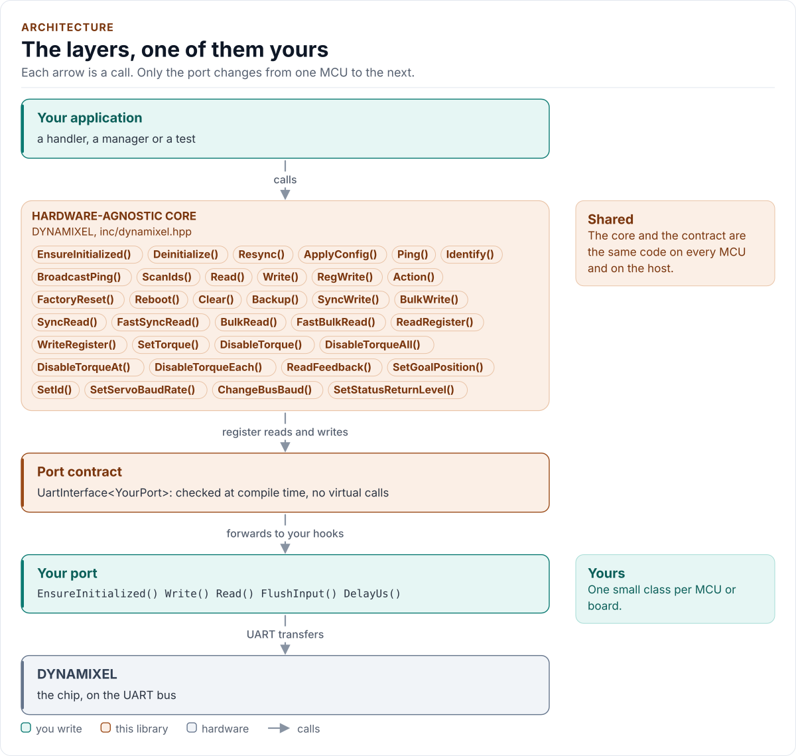
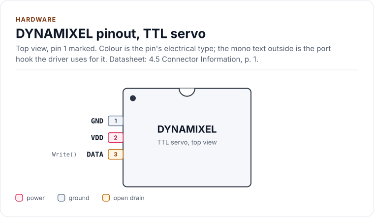
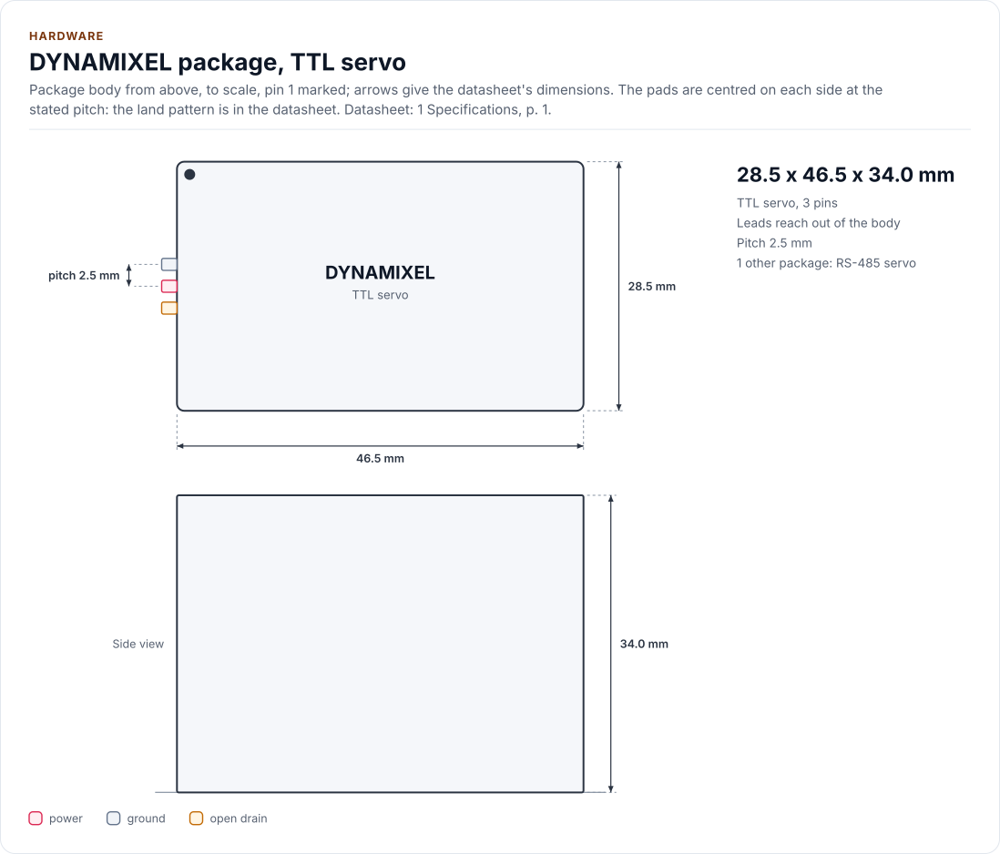
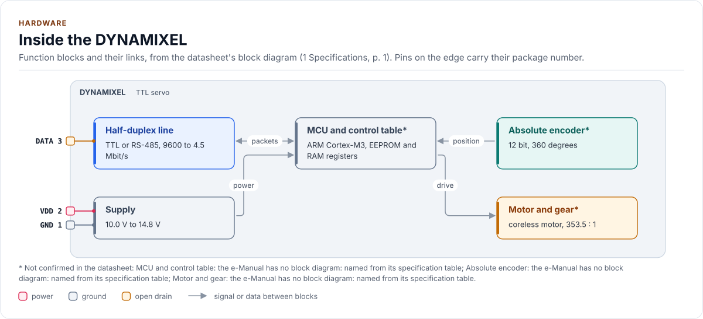

# DYNAMIXEL Driver

C++20 driver for the ROBOTIS DYNAMIXEL servo protocols 1.0 and 2.0 over a half-duplex UART.

[](https://github.com/kokeb-labs-drivers/driver-dynamixel/actions/workflows/ci.yml)
[](LICENSE)
[](docs/installation.md#requirements)

**Documentation: [`docs/`](docs/index.md)**, with the API reference built by Doxygen ([how](docs/api-reference.md)).
The site at <https://kokeb-labs-drivers.github.io/driver-dynamixel/> opens when the repository is public.


A DYNAMIXEL bus is one half-duplex data line shared by a master and up to 252 servos. This driver is the master: it
finds the servos, reads and writes their control tables by register name, reads many servos in one transaction and
turns a damaged, missing or refused reply into an error you can act on. It runs on any MCU: you give it a small class
that moves bytes on your UART, and it does the rest.

<!-- figure: driver-layers -->
<picture>
  <source media="(prefers-color-scheme: dark)" srcset="docs/diagrams/driver-layers.dark.svg">
  
</picture>
<!-- /figure -->

## At a glance

| | |
| --- | --- |
| **Servos** | ROBOTIS DYNAMIXEL: AX, RX, DX, MX, XL-320, XL330, XL430, XM, XH, XD, XW (47 model numbers); other models by raw address |
| **Bus** | Half-duplex TTL or RS-485 UART, 8N1, 9 600 to 4.5 Mbit/s; protocol 2.0 (CRC-16) or 1.0 (checksum), one per bus |
| **Does** | Ping and ID scan, Read, Write, Reg Write, Action, Reboot, Factory Reset, Clear, Backup, Sync and Bulk Read and Write, Fast Sync and Bulk Read |
| **Driver** | Header-only C++20; no heap, exceptions, RTTI or virtual calls; every call returns `Result<T>` |
| **Runs on** | Any MCU with a UART and a C++20 compiler; the host example runs on any PC ([Platforms](docs/platforms.md)) |
| **Status** | 0.1.0, not yet verified on hardware: host-tested against a bus model written separately from the driver |

<!-- figure: chip-pinout -->
<picture>
  <source media="(prefers-color-scheme: dark)" srcset="docs/diagrams/chip-pinout.dark.svg">
  
</picture>
<!-- /figure -->

<!-- figure: chip-outline -->
<picture>
  <source media="(prefers-color-scheme: dark)" srcset="docs/diagrams/chip-outline.dark.svg">
  
</picture>
<!-- /figure -->

<!-- figure: chip-blocks -->
<picture>
  <source media="(prefers-color-scheme: dark)" srcset="docs/diagrams/chip-blocks.dark.svg">
  
</picture>
<!-- /figure -->

<!-- generated: chip-card -->
| | | Datasheet |
| --- | --- | --- |
| **Package** | TTL servo | 4.5, p. 1 |
| **Pins** | 3 | 4.5, p. 1 |
| **Body size** | 28.5 x 46.5 x 34.0 mm | 1, p. 1 |
| **Pin pitch** | 2.5 mm | 4.5, p. 1 |
| **Variants** | `rs485` (below) | 4.5, p. 1 |
| **Supply VDD** | 10.0 V to 14.8 V | 1, p. 1 |

Also sold as:

| Variant | Package | Pins | Size | Ordering | Note | Datasheet |
| --- | --- | --- | --- | --- | --- | --- |
| `rs485` | RS-485 servo | 4 | 28.5 x 46.5 x 34 mm, 82 g | XM430-W350 (RS-485 port) | pin 3 DATA+, pin 4 DATA-; JST EHR-04 | 4.5, p. 1 |

From [`docs/hardware.yml`](docs/hardware.yml); pins, circuits and the block diagram: [Hardware](docs/hardware.md).
<!-- /generated -->

## Datasheet

<!-- generated: datasheet-card -->
| Document | Revision | Get it |
| --- | --- | --- |
| Protocol specification: DYNAMIXEL Protocol 2.0 (e-Manual) (ROBOTIS e-Manual, DYNAMIXEL Protocol 2.0) | web page, no revision mark, 2026-11-12 | [vendor page](https://emanual.robotis.com/docs/en/dxl/protocol2/) |
| Protocol specification: DYNAMIXEL Protocol 1.0 (e-Manual) (ROBOTIS e-Manual, DYNAMIXEL Protocol 1.0) | web page, no revision mark, 2026-11-12 | [vendor page](https://emanual.robotis.com/docs/en/dxl/protocol1/) |
| Protocol specification: CRC Calculation (e-Manual) (ROBOTIS e-Manual, CRC Calculation) | web page, no revision mark, 2026-11-12 | [vendor page](https://emanual.robotis.com/docs/en/dxl/crc/) |
| Servo manual: XM430-W350 (e-Manual): the X series reference (ROBOTIS e-Manual, XM430-W350) | web page, no revision mark, 2026-11-12 | [vendor page](https://emanual.robotis.com/docs/en/dxl/x/xm430-w350/) |
| Servo manual: AX-12A (e-Manual): the protocol 1.0 reference (ROBOTIS e-Manual, AX-12A) | web page, no revision mark, 2026-11-12 | [vendor page](https://emanual.robotis.com/docs/en/dxl/ax/ax-12a/) |
| Servo manual: XL-320 (e-Manual) (ROBOTIS e-Manual, XL-320) | web page, no revision mark, 2026-11-12 | [vendor page](https://emanual.robotis.com/docs/en/dxl/x/xl320/) |

Written against these revisions; the SHA-256 of each file is in [`docs/datasheets.yml`](docs/datasheets.yml). Where each
part of the driver is in the datasheet: [Datasheet map](docs/datasheet.md).
<!-- /generated -->

Every docs page lists the datasheet sections it relies on, and code comments cite the section they implement.

## Try it on your PC

No hardware needed: [`examples/host`](examples/host/README.md) runs the driver against a simulated bus of two servos.
You need git, CMake 3.16+ and a C++20 compiler (GCC 10+, Clang 13+ or MSVC 2022).

1. Get the source:

   ```bash
   git clone https://github.com/kokeb-labs-drivers/driver-dynamixel.git && cd driver-dynamixel
   ```

2. Build and run the example:

   ```bash
   cmake -S examples/host -B build-example
   cmake --build build-example
   ./build-example/dynamixel_host_example
   ```

3. You should see the driver find the two servos, move one and read both with one Sync Read:

   ```text
   DYNAMIXEL driver 0.1.0 on the host
   dynamixel: initialised
   servo 1: model 1020, firmware 46
   servo 2: model 1020, firmware 46
   servo 1: 31 C
   servo 2: 25 C
   torque off
   ```

To run the whole test suite instead: `cmake -S . -B build -DDYNAMIXEL_BUILD_TESTS=ON && cmake --build build && ctest
--test-dir build`.

## Use it on your MCU

**1. Wire it** ([Hardware](docs/hardware.md) has the pins, the circuit, the timing and the power):

| MCU | Servo bus | Notes |
| --- | --- | --- |
| UART TX and RX | DATA, through a half-duplex stage | 57 600 8N1 for an X-series servo at the factory settings |
| A GPIO or the UART's RTS | The stage's direction input | High while the MCU sends |
| GND | GND | Common with the servo supply |
| | VDD | 10.0 V to 14.8 V from its own supply (XM430-W350), never from the MCU board |

**2. Write the port**: a class with `EnsureInitialized()` (bring the UART up), `Write()` (send the whole packet, wait
for the last stop bit, listen again), `Read()` with a time-out in microseconds, `FlushInput()` and `DelayUs()`, about
30 lines on most SDKs. [Porting](docs/porting.md) has the contract and a complete example.

**3. Move a servo:**

<!-- generated: quickstart-code -->
```cpp
#include "dynamixel.hpp"

int move_first_servo(MyPort& port) {
  dynamixel::DYNAMIXEL<MyPort> servos(port); // protocol 2.0, 57 600 bit/s; no I/O yet

  if (auto r = servos.EnsureInitialized(); !r) { // 1. UART up
    return static_cast<int>(r.error);            //    Bus: check the UART and the wiring
  }
  const auto found = servos.Ping(1); // 2. who is there? model, firmware, family
  if (!found) {
    return static_cast<int>(found.error); //    Timeout: wrong ID, baud rate or protocol
  }
  const dynamixel::ServoRef servo{found.value.id, found.value.family};
  if (auto r = servos.SetTorque(servo, true); !r) { // 3. torque on
    return static_cast<int>(r.error);
  }
  return static_cast<int>(servos.SetGoalPosition(servo, 2048).error); // 4. half a turn
}
```
<!-- /generated -->

`EnsureInitialized()` brings the UART up and sends nothing on the bus. Every call that uses the bus returns
`Error::NotInitialized` until it has succeeded (argument and permission errors come first, and the torque-off calls
are never refused), and no call starts the driver on its own.

## What it does

- Speaks protocol 2.0 (CRC-16, byte stuffing) and protocol 1.0 (checksum) with Ping, Read, Write, Reg Write, Action,
  Reboot, Factory Reset, Clear, Control Table Backup, Sync and Bulk Read and Write, and Fast Sync and Bulk Read.
- Finds the reply in noisy bytes, the echo of a single-wire bus and late packets, and reports a stuck or floating
  line as `LineFault`, not as a timeout.
- Knows the control tables of 47 models in 9 families (AX, RX, DX, MX, XL-320, XL330, XL430, XM, XH, XD, XW), with
  units, ranges, signed and sign-magnitude decoding, indirect addresses and baud schemes.
- Reads many servos at once and gives each its own outcome, so one damaged part does not lose the others.
- Keeps destructive instructions (Factory Reset, Restore, Clear, an ID write to every servo) behind one
  configuration flag, and keeps the torque-off stop always available.
- Returns `Result<T>` with an `Error` from every call: no exceptions, no heap, no RTTI, no virtual calls.

## Add it to your project

Pick the row that matches your build; each is a few steps, and [Installation](docs/installation.md) has the
details.

| Your build | Steps below |
| --- | --- |
| Plain CMake: STM32 (CubeMX), RP2040 (Pico SDK), nRF Connect, a host app | [A](#a-cmake-any-mcu) |
| ESP-IDF | [B](#b-esp-idf) |
| An SDK or OS image that installs libraries | [C](#c-installed-package) |

### A. CMake, any MCU

1. Add the driver as a submodule, pinned to the version you chose:

   ```bash
   git submodule add https://github.com/kokeb-labs-drivers/driver-dynamixel.git external/driver-dynamixel
   ```

2. In your `CMakeLists.txt`, after `project()`:

   ```cmake
   add_subdirectory(external/driver-dynamixel)
   target_link_libraries(my_app PRIVATE dynamixel::dynamixel)   # brings the headers and C++20
   ```

3. In your code, `#include "dynamixel.hpp"`, write the port ([Porting](docs/porting.md)) and build. A first build
   that compiles the quickstart above is the check that the driver is wired in.

### B. ESP-IDF

1. Add the driver under your project's `components/`; ESP-IDF finds it there and names it after the folder:

   ```bash
   git submodule add https://github.com/kokeb-labs-drivers/driver-dynamixel.git components/dynamixel
   ```

2. In `main/CMakeLists.txt`, list it: `idf_component_register(SRCS "main.cpp" REQUIRES dynamixel)`.
3. `idf.py menuconfig` now has a **DYNAMIXEL servo bus** menu (protocol, bit rate, reply timeout, retries, echo),
   and `idf.py build` builds the driver with your app. [`examples/esp32`](examples/esp32) is a complete
   project with a port for the board.

### C. Installed package

1. Install it once into a prefix:

   ```bash
   cmake -S external/driver-dynamixel -B build-dynamixel && cmake --install build-dynamixel --prefix /opt/sdk
   ```

2. In your project, with `CMAKE_PREFIX_PATH=/opt/sdk`:

   ```cmake
   find_package(dynamixel 0.1 REQUIRED)
   target_link_libraries(my_app PRIVATE dynamixel::dynamixel)
   ```

The target is `dynamixel::dynamixel` every way, so switching later changes nothing else.

## Documentation

| Page | Read it when you want to |
| --- | --- |
| [Quickstart](docs/quickstart.md) | Go from a bare servo to a moving one on your MCU |
| [Hardware](docs/hardware.md) | Wire the bus, set the direction control, check the timing and the power |
| [Porting](docs/porting.md) | Write the port class for your MCU's SDK |
| [Protocol](docs/protocol.md) | Know the two packet formats, the CRC and how a reply is found |
| [Control tables](docs/control-tables.md) | Know the registers, units and families the driver supports |
| [API guide](docs/api-guide.md) | Use each call: find servos, typed registers, Sync and Fast reads, the stop, errors |
| [Configuration](docs/configuration.md) | Choose every setting, or start from a preset |
| [Troubleshooting](docs/troubleshooting.md) | Find the cause of an error or a servo that does not answer |
| [Contract](docs/contract.md) | Know exactly what the driver promises, needs and returns, and what is still open |
| [Datasheet map](docs/datasheet.md) | Find the e-Manual page behind each part of the driver |
| [API reference](docs/api-reference.md) | Look up a class or member (Doxygen; built by CI and locally) |

## Tests and quality

```bash
cmake -S . -B build -DDYNAMIXEL_BUILD_TESTS=ON && cmake --build build && ctest --test-dir build
```

The host tests run the driver against a model of the servo bus that is written separately from the driver, fail every
transfer in turn, and produce each error the driver can return. Two fuzz targets corrupt, cut and replace what the
servos send and check the driver's promises after every call, and a mutation run checks that the tests notice a
changed line. CI also builds for Cortex-M and gates coverage, complexity, sanitizers, fuzzing, clang-tidy, cppcheck
and the handbook rules (`.kokeb/handbook.yml`). See [Testing and CI](docs/testing.md), which lists every gate and its
limit.

## License

MIT. See [LICENSE](LICENSE).
