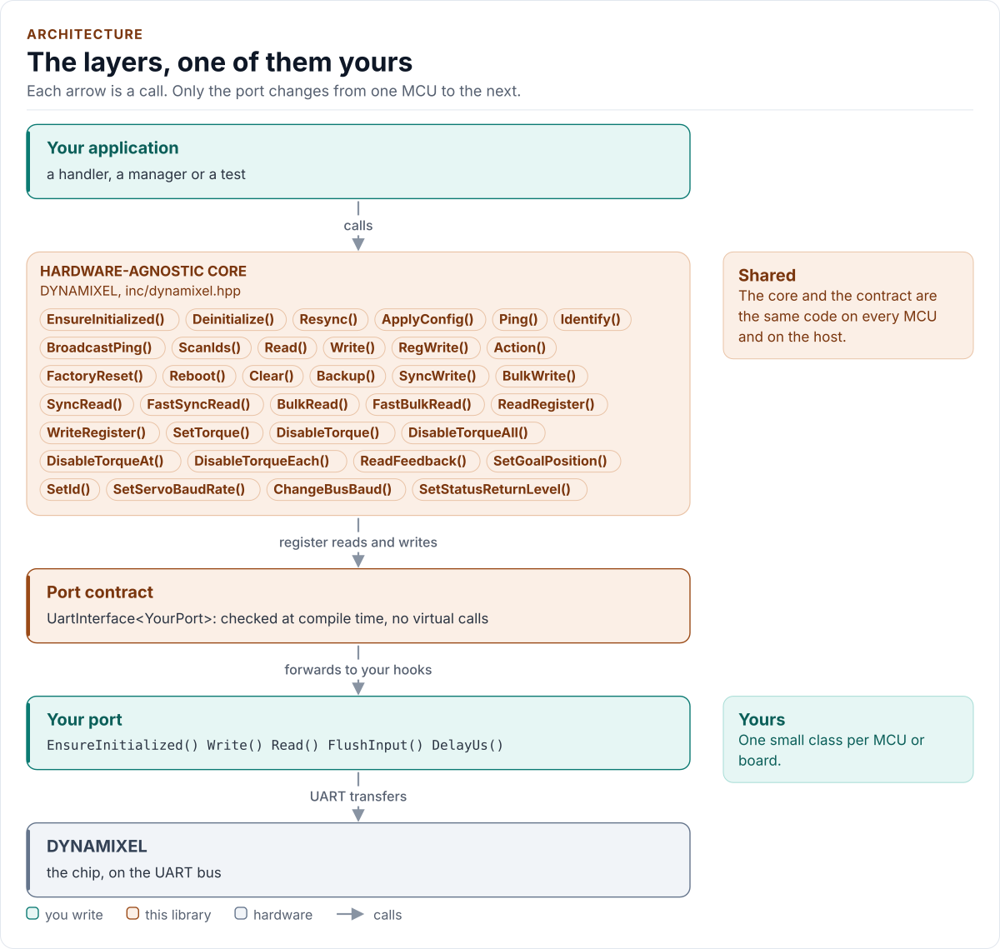
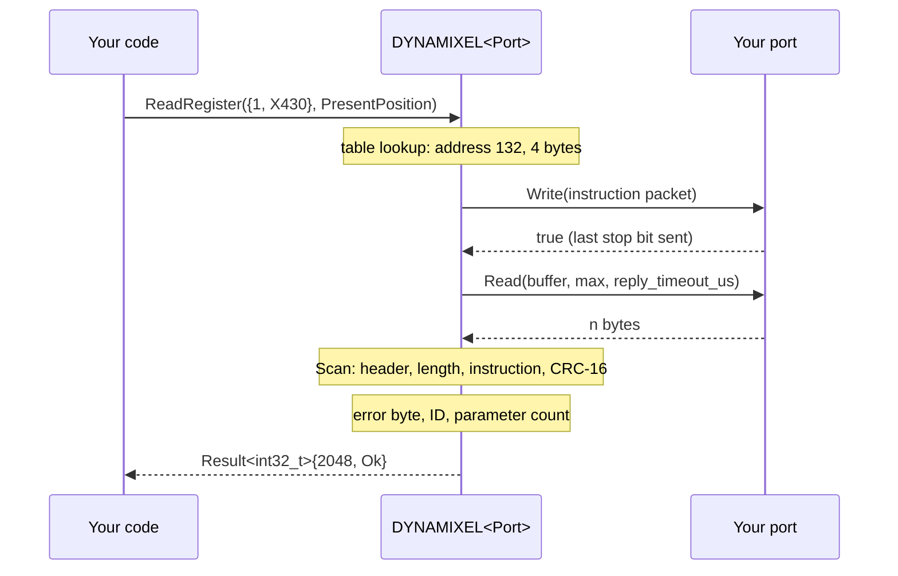

# Architecture

How the driver is built: the layers, one call from your code to the line and back, and the choices behind them,
including why there is no non-blocking API.

<!-- generated: datasheet-refs -->
??? abstract "Datasheet sections this page relies on"

    - Instruction packet layout: ROBOTIS e-Manual, DYNAMIXEL Protocol 2.0 web page, no revision mark, 2 Instruction Packet, p. 1
    - Packet process, header and byte stuffing: ROBOTIS e-Manual, DYNAMIXEL Protocol 2.0 web page, no revision mark, 4 Packet Process, p. 1
    - Protocol 1.0 packets and checksum: ROBOTIS e-Manual, DYNAMIXEL Protocol 1.0 web page, no revision mark, 2 Instruction Packet; 2.6 Checksum; 3 Status Packet; 3.2 Checksum, p. 1
    - CRC-16 of protocol 2.0 packets: ROBOTIS e-Manual, CRC Calculation web page, no revision mark, CRC Calculation, p. 1

    All of them, with the driver API for each: [Datasheet map](datasheet.md).
<!-- /generated -->

<!-- figure: driver-layers -->
<picture>
  <source media="(prefers-color-scheme: dark)" srcset="diagrams/driver-layers.dark.svg">
  
</picture>
<!-- /figure -->

## Layers

| Layer | Files | Owns |
| --- | --- | --- |
| Core | [`inc/dynamixel.hpp`](../inc/dynamixel.hpp), [`src/dynamixel.ipp`](../src/dynamixel.ipp) | Lifecycle, transactions, retries, Sync, Bulk and Fast reads, typed registers, the safe stop |
| Protocol | [`inc/dynamixel_protocol.hpp`](../inc/dynamixel_protocol.hpp) | Packet builder (`FrameWriter`), byte stuffing, CRC-16, checksum, the reply search (`Scan`), the Fast packet parts |
| Control tables | [`inc/dynamixel_tables.hpp`](../inc/dynamixel_tables.hpp) | The register table of each family, the 47 model numbers, units, the baud schemes, indirect addresses |
| Types | [`inc/dynamixel_types.hpp`](../inc/dynamixel_types.hpp) | `Error`, `Result<T>`, `Config` and its presets, `Feedback`, `DeviceReply`, `Stats`, `Validate()` |
| Port contract | [`inc/dynamixel_uart_interface.hpp`](../inc/dynamixel_uart_interface.hpp) | The CRTP base, the `UartPort` concept, the bus requirements |
| Platform port | Your class | The UART bring-up, byte transfers, the half-duplex direction, delays, optionally the baud rate and logging |
| Kconfig layer | [`inc/dynamixel_kconfig.hpp`](../inc/dynamixel_kconfig.hpp) | Optional: a `Config` from ESP-IDF menuconfig |

The protocol and table layers are pure functions of bytes and constants: they have no port and are tested alone.

## One call through the layers

A transaction is one `Write()` of the whole packet, then one or more `Read()` calls until a complete, valid status
packet is in the buffer or a deadline passes. A ping or a read that fails for a bad or missing reply is repeated up
to `Config::retries` times; a write is never repeated, because a write whose reply was lost may have been carried
out ([Protocol](protocol.md#finding-the-reply)).

## Design choices

- **CRTP, not virtual functions.** The port is a template parameter constrained by the `UartPort` concept, so every
  call is resolved at compile time and a missing hook is a compile error that names it.
- **Optional hooks by `requires`.** `SetBaudRate` and `Log` are detected with C++20 `requires` in one place, and
  their exact signature is checked: a hook that is declared wrongly does not compile. A missing `SetBaudRate()`
  leaves the port's own rate and makes `ChangeBusBaud()` return `Unsupported`; a missing `Log()` logs nothing.
- **No I/O in the constructor.** Construction cannot fail, so the driver can be a static or a member of a handler.
- **One error type.** `Result<T>` carries a value and an `Error`; nothing throws and nothing returns a bare
  `bool`. On failure the value is `T{}`.
- **Fixed buffers.** The driver owns one transmit and one receive buffer of `FrameBytes` bytes (512 by default, 64
  to 4096) and a 64-byte scratch buffer; a transfer that does not fit returns `InvalidArgument` before anything is
  sent. Nothing allocates.
- **One outcome per servo.** A multi-servo read does not collapse to one error: each `DeviceReply` carries the
  servo's own result, error byte and alert flag, and the call's `Result` says only whether the exchange as a whole
  worked.
- **Independent test model.** The host tests talk to a model of the bus written separately from the driver, so a
  misreading of the e-Manual in the driver is not copied into the test ([Testing and CI](testing.md)).

## Why there is no non-blocking API

Every call blocks until its reply is complete or its deadlines have passed. The driver has no `Start` and `Poll`
pair, and this is deliberate:

- **The line is half duplex and shared.** Between an instruction and its status packet no other instruction may be
  sent, and a servo answers within a few hundred microseconds. A caller that starts a read and returns to do other
  work cannot send anything else on the bus until the reply is in, so the bus is blocked either way; splitting the
  call only moves the wait into the caller.
- **The wait is short.** A read of one servo at 1 Mbit/s takes well under a millisecond; at the default 57 600
  bit/s about 5 ms. `Config::reply_timeout_us` bounds the wait for a servo that does not answer.
- **Fast reads are the answer to many servos.** `SyncRead()` and `FastSyncRead()` collect many servos in one
  transaction, so a control loop reads the whole arm in one call instead of one call per servo.
- **A state machine would need a clock and an interrupt-safe line.** Receiving into the driver from an ISR would
  put a lock or a lock-free queue into a library that has none. A port can still make `Read()` cooperative (an RTOS
  queue with a timeout, as the ESP32 port does), so other tasks run while the driver waits.

Run the driver from one task, give it the bus, and use the Sync and Fast reads for the multi-servo case. If you need
a call that never waits at all, wrap the driver in a task and talk to it with a queue; the driver stays blocking
and the task decides what blocks.

## Source map

| You want | Read |
| --- | --- |
| The public API | [`inc/dynamixel.hpp`](../inc/dynamixel.hpp) |
| How a call is implemented | [`src/dynamixel.ipp`](../src/dynamixel.ipp) |
| The packets and the reply search | [`inc/dynamixel_protocol.hpp`](../inc/dynamixel_protocol.hpp), [Protocol](protocol.md) |
| The registers of a family | [`inc/dynamixel_tables.hpp`](../inc/dynamixel_tables.hpp), [Control tables](control-tables.md) |
| The port contract | [`inc/dynamixel_uart_interface.hpp`](../inc/dynamixel_uart_interface.hpp) |

Next: [Contract](contract.md).
