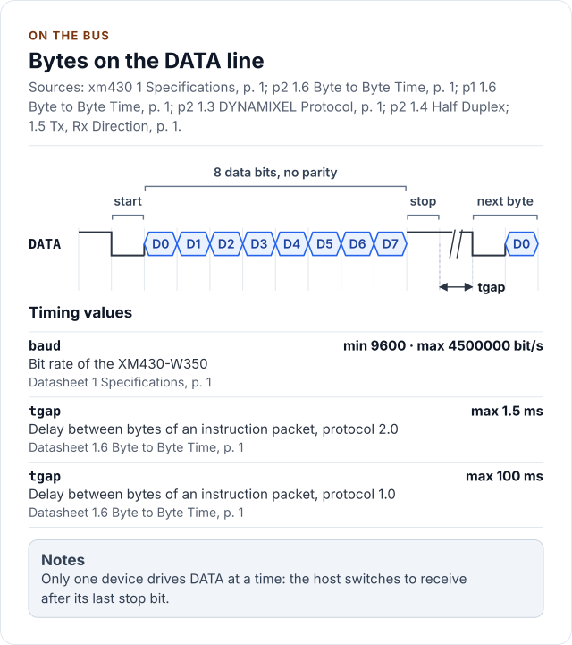
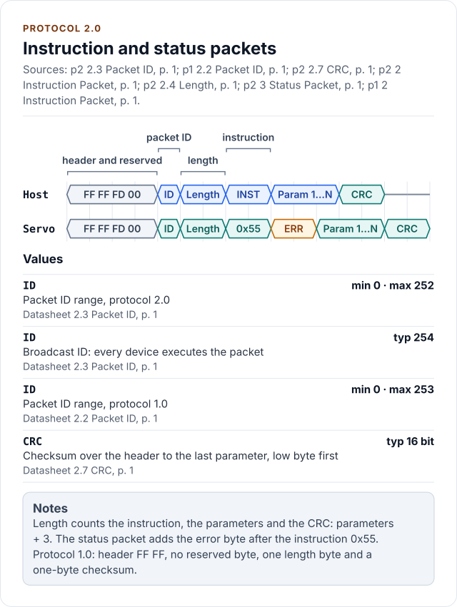
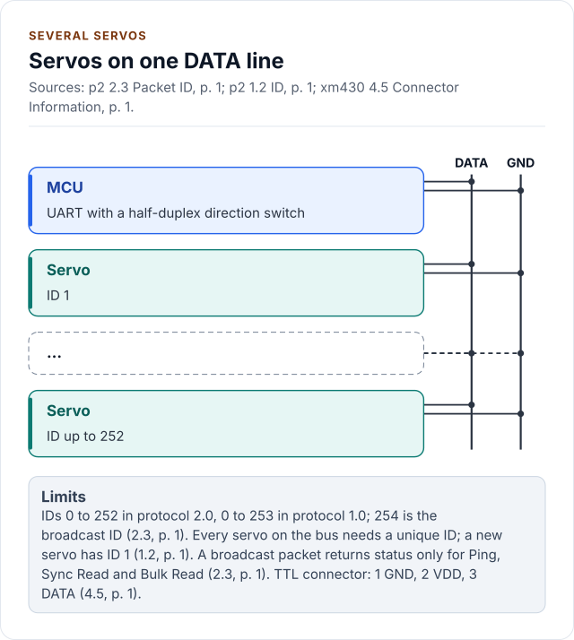

# On the bus

What a DYNAMIXEL bus needs from the host's UART, and what one exchange of packets carries, with every number taken
from the ROBOTIS e-Manual pages in the [Datasheet map](datasheet.md): the Protocol 2.0 and Protocol 1.0 pages and the
XM430-W350 page, the reference servo. The e-Manual pages have no printed page numbers, so each citation names the
page's own section heading. The byte stuffing and the reply search are on the [Protocol](protocol.md) page.

## UART

The DATA line is a half-duplex UART: 8 data bits, one stop bit, no parity, and only one device drives it at a time.
The bytes of one instruction packet must follow each other closely, or the servo drops the packet and waits for the
next header.

<!-- figure: uart-timing -->
<picture>
  <source media="(prefers-color-scheme: dark)" srcset="diagrams/uart-timing.dark.svg">
  
</picture>
<!-- /figure -->

## One exchange

The host sends an instruction packet; the addressed servo answers with a status packet after its return delay time.
Both packets share the header, the packet ID, the length and the instruction fields; the status packet adds the error
byte. Protocol 1.0 packets have a shorter header, one length byte and a one-byte checksum.

<!-- figure: servo-packet -->
<picture>
  <source media="(prefers-color-scheme: dark)" srcset="diagrams/servo-packet.dark.svg">
  
</picture>
<!-- /figure -->

## Several devices

Every servo on the bus shares the one DATA line and answers only to its own ID; a packet to the broadcast ID reaches
all of them.

<!-- figure: uart-topology -->
<picture>
  <source media="(prefers-color-scheme: dark)" srcset="diagrams/uart-topology.dark.svg">
  
</picture>
<!-- /figure -->

## How these figures are made

Each figure is a model in `docs/model/` (`uart-timing.timing.yml`, `servo-packet.timing.yml` and
`uart-topology.topology.yml`) that cites the e-Manual section of every number; `kokeb-docs figures` draws it and the
build fails on a number without a citation. The values table under each figure is also written as
`docs/diagrams/<id>.table.html`.
