# Figures

<!-- Written by kokeb-docs figures from docs/diagrams/figures/*.py. Do not edit by hand. -->

Every figure on this site is drawn by a Python module from facts extracted from the code, so it is rebuilt,
not redrawn, when the code changes. CI runs `kokeb-docs figures --check` and fails when a
committed figure no longer matches the code. Each figure below lists the files it is drawn from.

## Inside the DYNAMIXEL

<!-- figure: chip-blocks -->
<picture>
  <source media="(prefers-color-scheme: dark)" srcset="chip-blocks.dark.svg">
  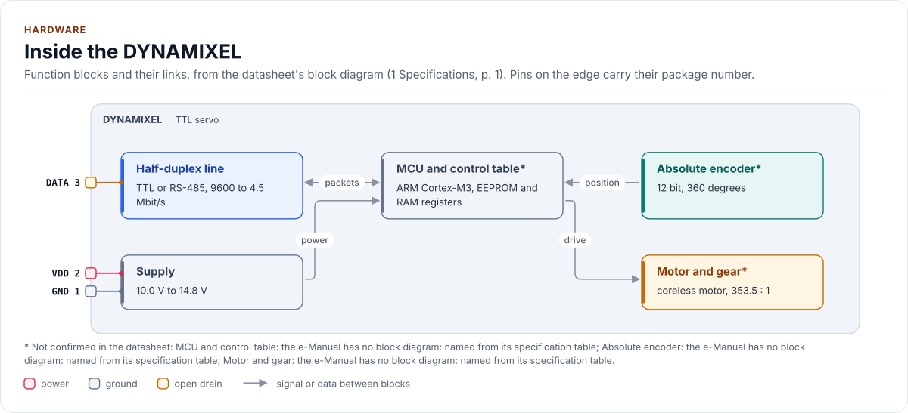
</picture>
<!-- /figure -->

Hardware description: [`docs/hardware.yml`](../hardware.yml)

Drawn from:

- [`docs/hardware.yml`](../hardware.yml)
- [`inc/dynamixel_uart_interface.hpp`](../../inc/dynamixel_uart_interface.hpp)

## What the DYNAMIXEL does

<!-- figure: chip-capabilities -->
<picture>
  <source media="(prefers-color-scheme: dark)" srcset="chip-capabilities.dark.svg">
  
</picture>
<!-- /figure -->

Hardware description: [`docs/hardware.yml`](../hardware.yml)

Drawn from:

- [`docs/hardware.yml`](../hardware.yml)
- [`inc/dynamixel_uart_interface.hpp`](../../inc/dynamixel_uart_interface.hpp)

## DYNAMIXEL: servo bus on an MCU's UART through a half-duplex stage

<!-- figure: chip-circuit-typical -->
<picture>
  <source media="(prefers-color-scheme: dark)" srcset="chip-circuit-typical.dark.svg">
  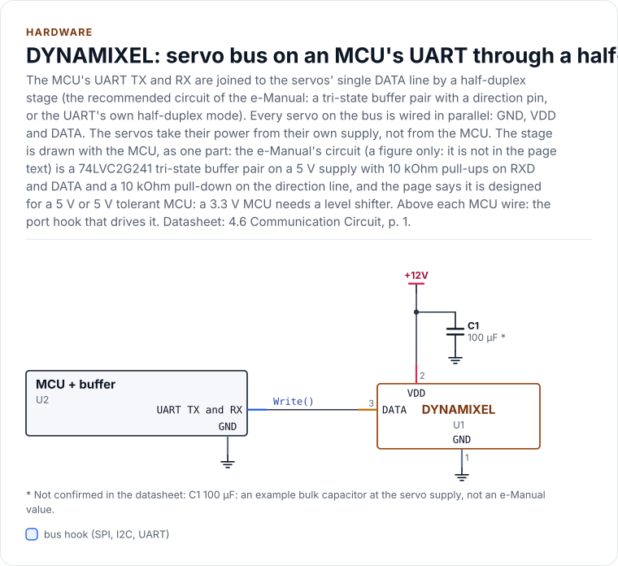
</picture>
<!-- /figure -->

Hardware description: [`docs/hardware.yml`](../hardware.yml)

Drawn from:

- [`docs/hardware.yml`](../hardware.yml)
- [`inc/dynamixel_uart_interface.hpp`](../../inc/dynamixel_uart_interface.hpp)

## DYNAMIXEL

<!-- figure: chip-hero -->
<picture>
  <source media="(prefers-color-scheme: dark)" srcset="chip-hero.dark.svg">
  
</picture>
<!-- /figure -->

Hardware description: [`docs/hardware.yml`](../hardware.yml)

Drawn from:

- [`docs/hardware.yml`](../hardware.yml)
- [`inc/dynamixel_uart_interface.hpp`](../../inc/dynamixel_uart_interface.hpp)

## DYNAMIXEL package, TTL servo

<!-- figure: chip-outline -->
<picture>
  <source media="(prefers-color-scheme: dark)" srcset="chip-outline.dark.svg">
  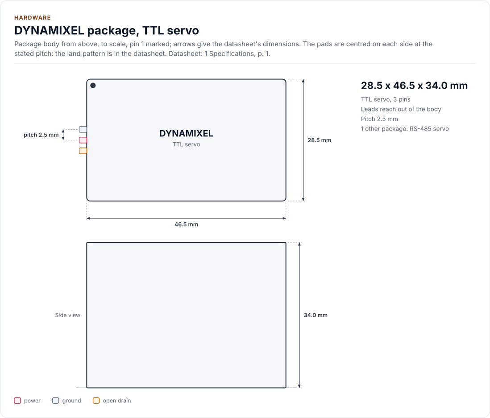
</picture>
<!-- /figure -->

Hardware description: [`docs/hardware.yml`](../hardware.yml)

Drawn from:

- [`docs/hardware.yml`](../hardware.yml)
- [`inc/dynamixel_uart_interface.hpp`](../../inc/dynamixel_uart_interface.hpp)

## DYNAMIXEL pinout, TTL servo

<!-- figure: chip-pinout -->
<picture>
  <source media="(prefers-color-scheme: dark)" srcset="chip-pinout.dark.svg">
  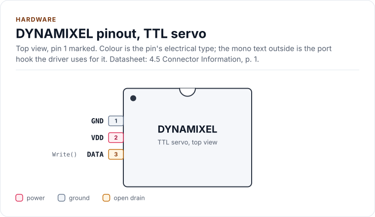
</picture>
<!-- /figure -->

Hardware description: [`docs/hardware.yml`](../hardware.yml)

Drawn from:

- [`docs/hardware.yml`](../hardware.yml)
- [`inc/dynamixel_uart_interface.hpp`](../../inc/dynamixel_uart_interface.hpp)

## Wiring: servo bus on an MCU's UART through a half-duplex stage

<!-- figure: chip-wiring-typical -->
<picture>
  <source media="(prefers-color-scheme: dark)" srcset="chip-wiring-typical.dark.svg">
  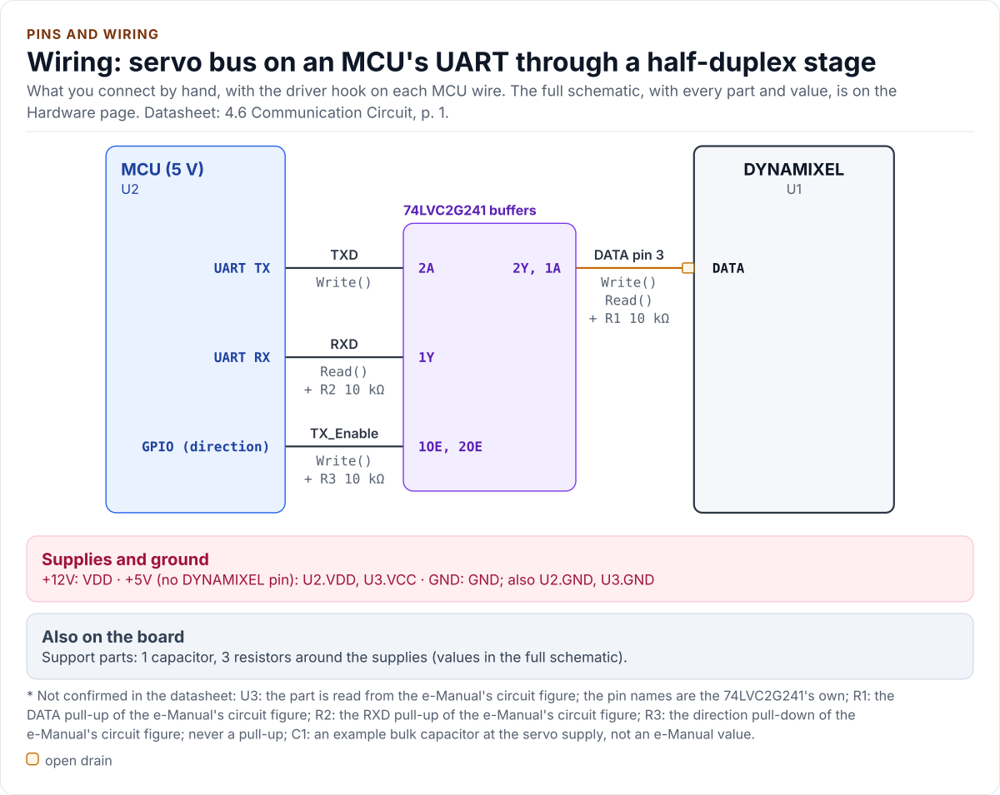
</picture>
<!-- /figure -->

Hardware description: [`docs/hardware.yml`](../hardware.yml)

Drawn from:

- [`docs/hardware.yml`](../hardware.yml)
- [`inc/dynamixel_uart_interface.hpp`](../../inc/dynamixel_uart_interface.hpp)

## One read on the half-duplex data line

<!-- figure: data-line-read -->
<picture>
  <source media="(prefers-color-scheme: dark)" srcset="data-line-read.dark.svg">
  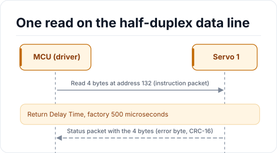
</picture>
<!-- /figure -->

Hardware description: [`docs/model/data-line-read.seq.yml`](../model/data-line-read.seq.yml)

Drawn from:

- [`docs/model/data-line-read.seq.yml`](../model/data-line-read.seq.yml)

## The layers, one of them yours

<!-- figure: driver-layers -->
<picture>
  <source media="(prefers-color-scheme: dark)" srcset="driver-layers.dark.svg">
  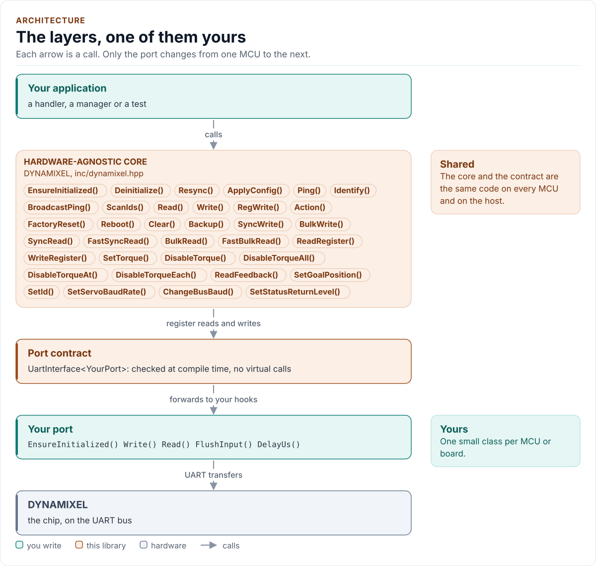
</picture>
<!-- /figure -->

Figure module: [`docs/diagrams/figures/driver-layers.py`](../../docs/diagrams/figures/driver-layers.py)

Drawn from:

- `public calls` in [`inc/dynamixel.hpp`](../../inc/dynamixel.hpp)
- `UartInterface` in [`inc/dynamixel_uart_interface.hpp`](../../inc/dynamixel_uart_interface.hpp)

## One call through the layers

<!-- figure: one-call-through-the-layers -->
<picture>
  <source media="(prefers-color-scheme: dark)" srcset="one-call-through-the-layers.dark.svg">
  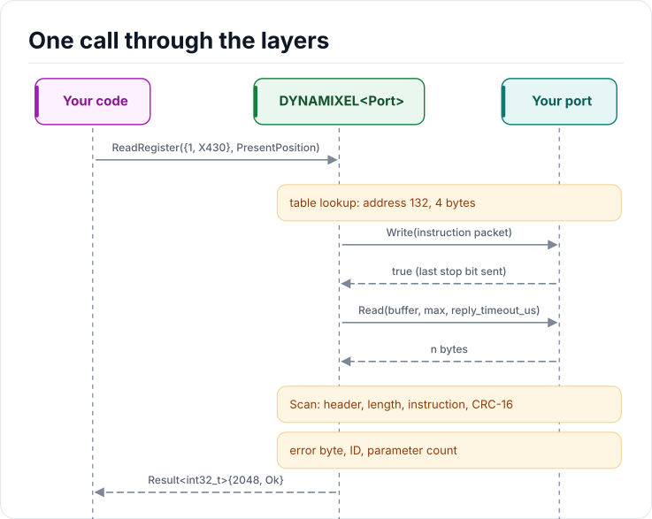
</picture>
<!-- /figure -->

Hardware description: [`docs/model/one-call-through-the-layers.seq.yml`](../model/one-call-through-the-layers.seq.yml)

Drawn from:

- [`docs/model/one-call-through-the-layers.seq.yml`](../model/one-call-through-the-layers.seq.yml)

## Instruction and status packets

<!-- figure: servo-packet -->
<picture>
  <source media="(prefers-color-scheme: dark)" srcset="servo-packet.dark.svg">
  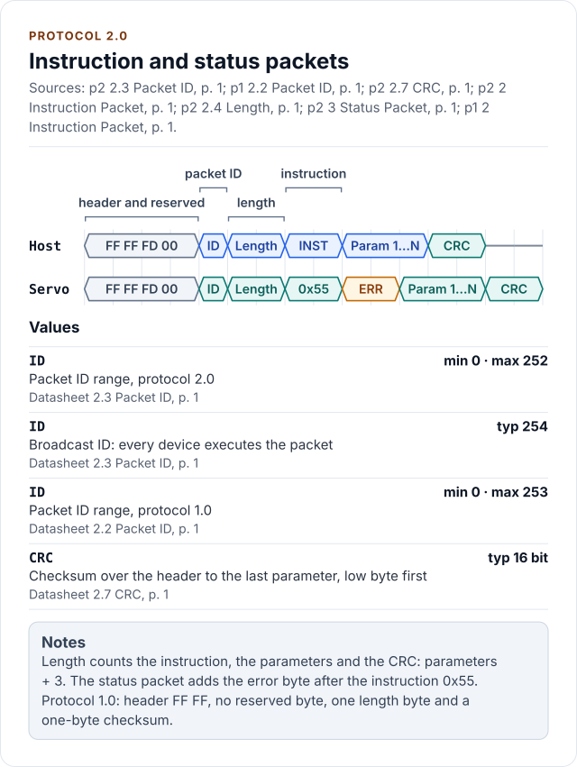
</picture>
<!-- /figure -->

Hardware description: [`docs/model/servo-packet.timing.yml`](../model/servo-packet.timing.yml)

Drawn from:

- [`docs/model/servo-packet.timing.yml`](../model/servo-packet.timing.yml)

## Bytes on the DATA line

<!-- figure: uart-timing -->
<picture>
  <source media="(prefers-color-scheme: dark)" srcset="uart-timing.dark.svg">
  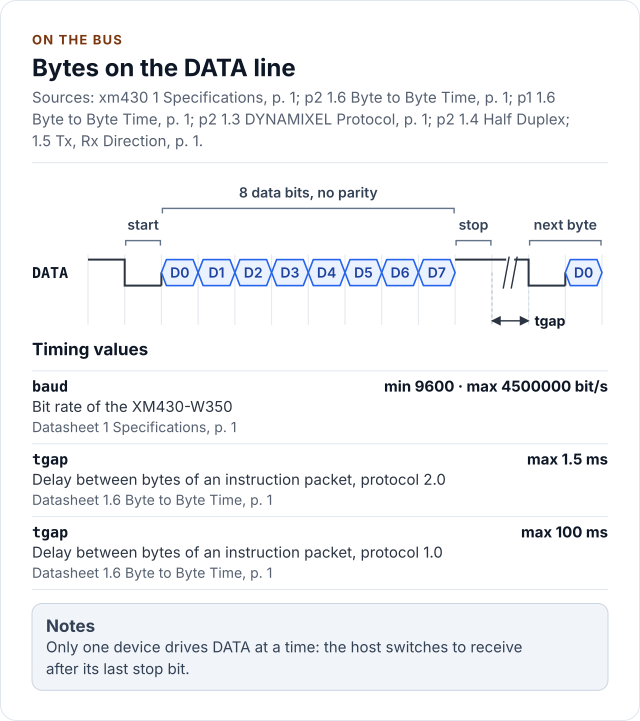
</picture>
<!-- /figure -->

Hardware description: [`docs/model/uart-timing.timing.yml`](../model/uart-timing.timing.yml)

Drawn from:

- [`docs/model/uart-timing.timing.yml`](../model/uart-timing.timing.yml)

## Servos on one DATA line

<!-- figure: uart-topology -->
<picture>
  <source media="(prefers-color-scheme: dark)" srcset="uart-topology.dark.svg">
  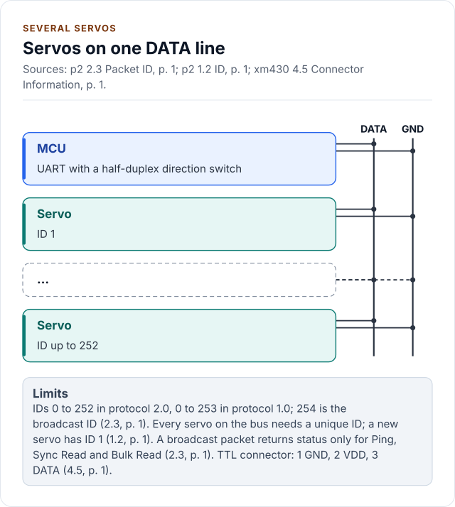
</picture>
<!-- /figure -->

Hardware description: [`docs/model/uart-topology.topology.yml`](../model/uart-topology.topology.yml)

Drawn from:

- [`docs/model/uart-topology.topology.yml`](../model/uart-topology.topology.yml)
