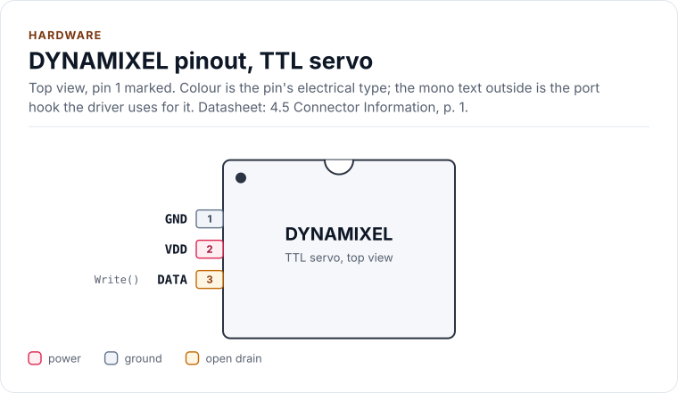
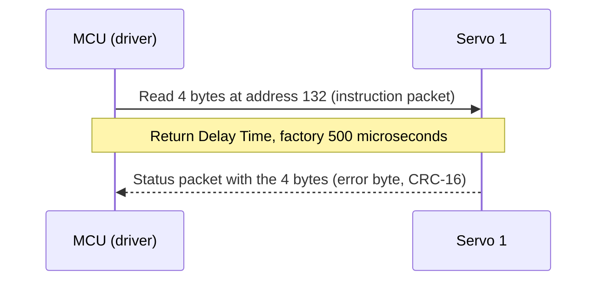
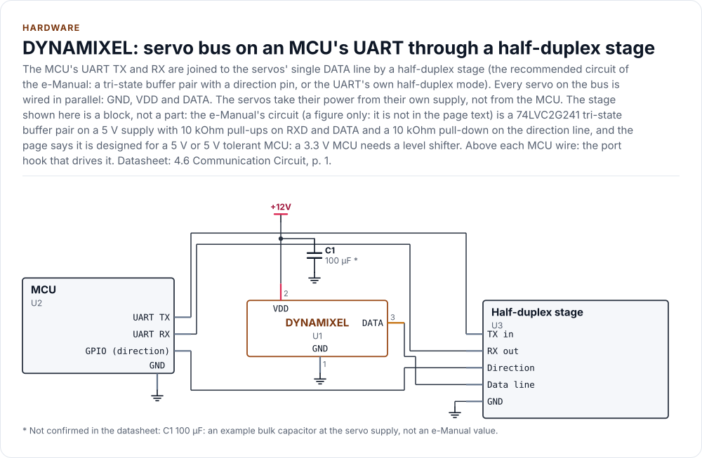
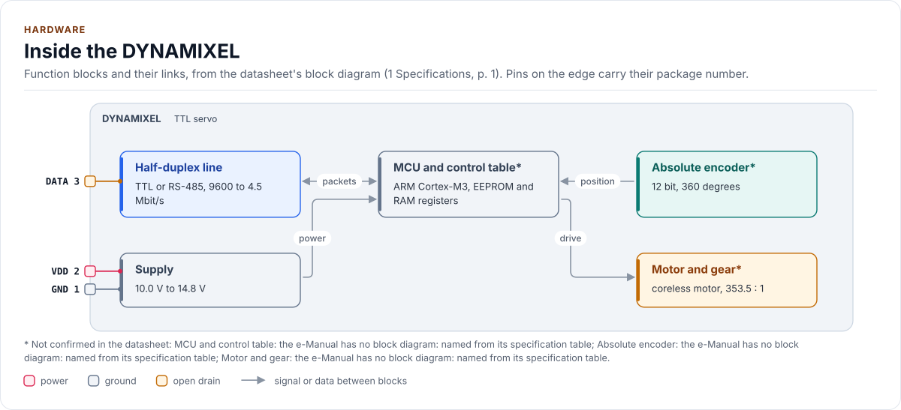
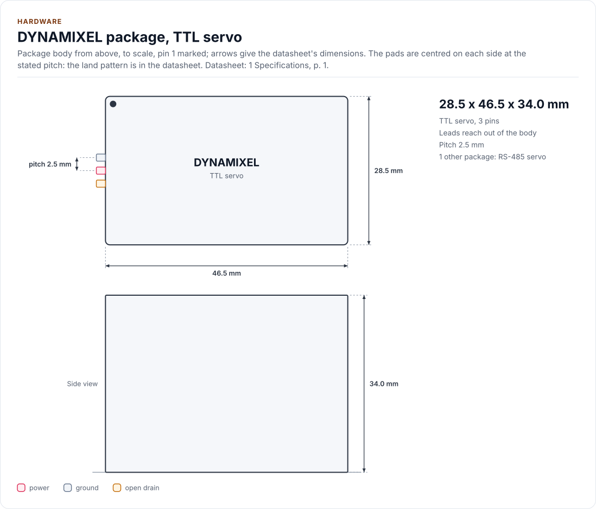

# Hardware

How a DYNAMIXEL servo bus is wired and timed, as the driver uses it: the connector, the half-duplex data line, the
bus settings, the timing and the supply.

The driver talks to a family of servos, not to one chip. The reference part of this page is the XM430-W350; the
other families differ in the connector housing and the supply range ([Control tables](control-tables.md)). Not
verified on hardware: everything here follows the ROBOTIS e-Manual, which is a set of web pages (see the
[Datasheet map](datasheet.md)).

<!-- generated: datasheet-refs -->
??? abstract "Datasheet sections this page relies on"

    - Half duplex line and Tx/Rx direction: ROBOTIS e-Manual, DYNAMIXEL Protocol 2.0 web page, no revision mark, 1.4 Half Duplex; 1.5 Tx, Rx Direction, p. 1
    - Specifications, baud rates and ID range: ROBOTIS e-Manual, XM430-W350 web page, no revision mark, 1 Specifications, p. 1
    - Connector, power and communication circuit: ROBOTIS e-Manual, XM430-W350 web page, no revision mark, 4.5 Connector Information; 4.6 Communication Circuit, p. 1
    - Connector and half-duplex circuit, protocol 1.0 servos: ROBOTIS e-Manual, AX-12A web page, no revision mark, 5.2 Connector Information; 5.4 Communication Circuit, p. 1

    All of them, with the driver API for each: [Datasheet map](datasheet.md).
<!-- /generated -->

!!! warning "The servos need their own supply"
    The XM430-W350 runs from 10.0 V to 14.8 V (12.0 V recommended) and draws amperes when it moves. Never power it
    from the MCU board. The TTL connector carries a single TTL data line (the e-Manual's text gives no voltage
    level; its circuit figure pulls the line up to 5 V, see Circuits below); the RS-485 variant is differential and
    needs a transceiver.

## Pins

The 3-pin TTL connector of the X series (JST EH) carries ground, the supply and one half-duplex data line. The
RS-485 variant has the same first two pins and splits the data into DATA+ and DATA-.

<!-- figure: chip-pinout -->
<picture>
  <source media="(prefers-color-scheme: dark)" srcset="diagrams/chip-pinout.dark.svg">
  
</picture>
<!-- /figure -->

<!-- generated: chip-pins -->
TTL servo, 3 pins (4.5 Connector Information, p. 1).

| Pin | Name | Type (domain) | Function | Driver hook | Datasheet |
| --- | --- | --- | --- | --- | --- |
| 1 | `GND` | ground | Ground and the negative supply (pin 1 of the connector) | - | 4.5, p. 1 |
| 2 | `VDD` | power (VDD) | Positive supply, 10.0 V to 14.8 V, 12.0 V recommended (XM430-W350) | - | 1, p. 1 |
| 3 | `DATA` | open drain (TTL, 5 V in the circuit) | Half-duplex TTL data line, 8N1: the master and every servo share it. The master's TX and RX meet here (single wire), so a sent byte is also read back unless the adapter gates it. The page text gives no voltage level; the circuit figure shows a 10 kOhm pull-up to 5 V. Unverified: the drive type (open drain) is not stated | `Write()` | 4.5, p. 1 |

Source of this table and of the chip figures: [`docs/hardware.yml`](hardware.yml).
<!-- /generated -->

The driver has no pin of its own to drive: the only hooks are `Write()` and `Read()` of your UART port. The
direction of the half-duplex stage is part of `Write()` ([Porting](porting.md)).

## The data line

All servos and the master share one data line. The master sends an instruction packet; the addressed servo answers
with a status packet after its Return Delay Time (500 microseconds at the factory value, up to 508). Between the
two the line must be turned round: the master stops driving it and listens.

| Wiring | How the direction is switched | Port | `Config::echo` |
| --- | --- | --- | --- |
| UART with a direction pin (RS-485 transceiver, tri-state buffer) | The UART's RTS output or a GPIO, high while sending | `Write()` raises it, sends, waits for the last stop bit and lowers it | `None` |
| UART with a hardware half-duplex mode (ESP32 `UART_MODE_RS485_HALF_DUPLEX`) | The hardware, with the first start bit and after the last stop bit | `Write()` sends and waits for the transmitter to be done | `None` |
| TX and RX tied to the single wire (open-drain or diode stage) | None: the master's own bytes come back on RX | `Write()` leaves the echo in the receive FIFO | `Loopback` |

With `EchoMode::Loopback` the driver reads the echo of every packet it sent and compares it with the request:
another talker on the line, or a short, shows as `Error::EchoMismatch` before any reply is waited for.

## Bus settings

| Setting | Value |
| --- | --- |
| UART format | 8 data bits, no parity, 1 stop bit |
| Bit rate | About 7 800 (AX-12A) or 9 600 to 4 500 000 bit/s on the catalogued families; factory 57 600 (X series) or 1 000 000 (protocols 1.0 families); every servo on the bus must run the same rate |
| Packet | Protocol 1.0 or 2.0, the same for every servo on the bus ([Protocol](protocol.md)) |
| Byte gap inside an instruction | At most 1.5 ms in protocol 2.0 and 100 ms in protocol 1.0, or the servo drops the packet: `Write()` sends the packet in one go |
| IDs | 0 to 252 (2.0) or 0 to 253 (1.0); 254 is the broadcast ID; every ID on a bus must be unique |

The factory bit rate and ID differ by family: an X-series servo comes at ID 1 and 57 600 bit/s, an AX-12A at ID 1
and 1 000 000 bit/s. `Config::baud` must match; a wrong rate looks like silence (`Error::Timeout`) or noise.

## Circuits

<!-- figure: chip-circuit-typical -->
<picture>
  <source media="(prefers-color-scheme: dark)" srcset="diagrams/chip-circuit-typical.dark.svg">
  
</picture>
<!-- /figure -->

The e-Manual's recommended TTL circuit is a pair of tri-state buffers (a 74LVC2G241 in the figure), one for each
direction. One direction signal (`TX_Enable`) drives both enables: low enables the receive buffer (servo DATA to the
MCU's RXD), high enables the transmit buffer (the MCU's TXD to DATA). The circuit is a figure only: the page text says
that it "is designed for 5V or 5V tolerant MCU. Otherwise, use a Level Shifter to match the voltage of MCU", and the
figure runs the buffers from 5 V. It has a 10 kilohm pull-up to 5 V on the RXD node and on the DATA node, and a 10
kilohm pull-**down** to ground on `TX_Enable`, so that the stage listens while the MCU pin is not driven. Do not
copy the enable resistor as a pull-up: a pull-up on the direction pin would enable the transmit buffer and drive DATA
high at idle, against the servos' own answers. **A 3.3 V MCU therefore needs a level shifter**; the e-Manual shows no
3.3 V circuit. What is read from the figure (the part name, the 5 V supply, the pull-ups and the pull-down) is
unverified against a second source. The stage drawn here is a block, not a part; any circuit that gives
the same behaviour (an RS-485 transceiver with the right level, or a UART's own half-duplex mode) works the same way
for the driver. Add a bulk capacitor on the servo supply; the 100 microfarad of the drawing is an example, not a
datasheet value.

## Inside the servo

<!-- figure: chip-blocks -->
<picture>
  <source media="(prefers-color-scheme: dark)" srcset="diagrams/chip-blocks.dark.svg">
  
</picture>
<!-- /figure -->

The e-Manual has no block diagram; this one is drawn from its specification table, and the blocks are marked as
unverified in [`hardware.yml`](hardware.yml).

## Mechanical

<!-- figure: chip-outline -->
<picture>
  <source media="(prefers-color-scheme: dark)" srcset="diagrams/chip-outline.dark.svg">
  
</picture>
<!-- /figure -->

## Timing

| Parameter | Value | Driver |
| --- | --- | --- |
| Return Delay Time | 500 microseconds at the factory value, at most 508 (register, 2 microsecond counts) | `kTurnaroundUs`, `kMaxTurnaroundUs`; `Config::reply_timeout_us` must be longer |
| Reply wait | Not specified by the e-Manual | `Config::reply_timeout_us`, 20 ms by default (100 microseconds to 1 s) |
| Wait inside a packet | Not specified | `Config::gap_timeout_us`, 5 ms by default |
| Reboot, restore, factory reset | The servo restarts after its reply | `Config::reboot_wait_us`, 500 ms by default |
| Baud rate change | The servo switches after the reply | `Config::baud_change_wait_us`, 10 ms by default |
| Broadcast ping | The servos answer in ID order | `Config::broadcast_timeout_us` per reply, 100 ms by default |

A byte takes ten bit times: 174 microseconds at 57 600 bit/s, 10 microseconds at 1 Mbit/s. A Fast Sync Read of
many servos at a low rate needs a `reply_timeout_us` that covers the whole packet; the driver waits per read, not
for the whole packet ([Configuration](configuration.md)).

## Power

| Quantity | XM430-W350 |
| --- | --- |
| Supply voltage | 10.0 V to 14.8 V, 12.0 V recommended |
| Stall current | 2.1 A at 11.1 V, 2.3 A at 12.0 V |
| Standby current | 40 mA |

The servo reports its input voltage in 0.1 V counts (`Reg::PresentInputVoltage`; it shows in `ReadFeedback()`).
Other families run from 5 V to 12 V or more; check the e-Manual page of the model.

## Reference documents

The datasheets are the ROBOTIS e-Manual pages for protocols 1.0 and 2.0 and for the models of the catalogue. Every
pin, setting and timing on this page cites a section; the revision, the SHA-256 of the saved HTML and the sections
each page relies on are in [`docs/datasheets.yml`](datasheets.yml).

<!-- generated: datasheet-card -->
| Document | Revision | Get it |
| --- | --- | --- |
| Protocol specification: DYNAMIXEL Protocol 2.0 (e-Manual) (ROBOTIS e-Manual, DYNAMIXEL Protocol 2.0) | web page, no revision mark, 2026-11-12 | [vendor page](https://emanual.robotis.com/docs/en/dxl/protocol2/) |
| Protocol specification: DYNAMIXEL Protocol 1.0 (e-Manual) (ROBOTIS e-Manual, DYNAMIXEL Protocol 1.0) | web page, no revision mark, 2026-11-12 | [vendor page](https://emanual.robotis.com/docs/en/dxl/protocol1/) |
| Protocol specification: CRC Calculation (e-Manual) (ROBOTIS e-Manual, CRC Calculation) | web page, no revision mark, 2026-11-12 | [vendor page](https://emanual.robotis.com/docs/en/dxl/crc/) |
| Servo manual: XM430-W350 (e-Manual): the X series reference (ROBOTIS e-Manual, XM430-W350) | web page, no revision mark, 2026-11-12 | [vendor page](https://emanual.robotis.com/docs/en/dxl/x/xm430-w350/) |
| Servo manual: AX-12A (e-Manual): the protocol 1.0 reference (ROBOTIS e-Manual, AX-12A) | web page, no revision mark, 2026-11-12 | [vendor page](https://emanual.robotis.com/docs/en/dxl/ax/ax-12a/) |
| Servo manual: XL-320 (e-Manual) (ROBOTIS e-Manual, XL-320) | web page, no revision mark, 2026-11-12 | [vendor page](https://emanual.robotis.com/docs/en/dxl/x/xl320/) |

Written against these revisions; the SHA-256 of each file is in [`docs/datasheets.yml`](datasheets.yml). Where each part
of the driver is in the datasheet: [Datasheet map](datasheet.md).
<!-- /generated -->

| Also useful | Contents |
| --- | --- |
| [`inc/dynamixel_tables.hpp`](../inc/dynamixel_tables.hpp) | The control table of every family, with the e-Manual page of each |
| [`inc/dynamixel_protocol.hpp`](../inc/dynamixel_protocol.hpp) | The packet layout, stuffing, CRC and the reply search |
