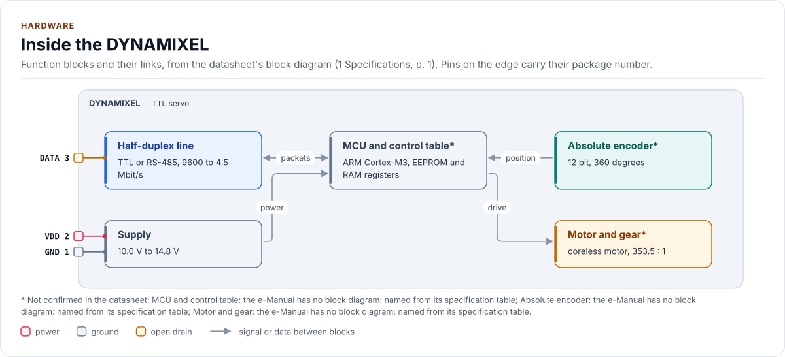
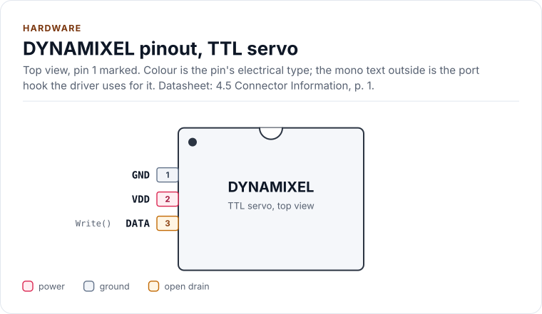
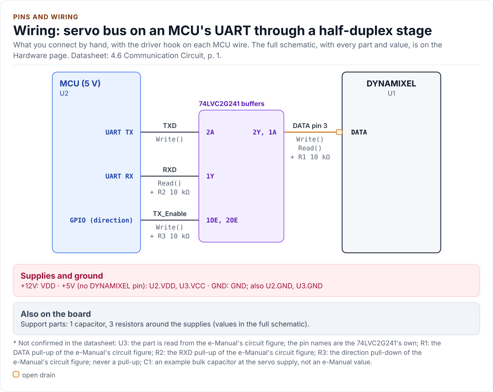

---
hide:
  - navigation
  - toc
---

<div class="kb-hero" markdown>
<span class="kb-kicker">Smart servo actuator</span>

# DYNAMIXEL Driver

<p>A C++20 bus-master driver for ROBOTIS DYNAMIXEL servos. It speaks protocol 1.0 and 2.0 over a half-duplex UART,
finds the servos, reads and writes their control tables by name, and runs Sync, Bulk and Fast reads, on any MCU.</p>

[Quickstart](quickstart.md){ .md-button .md-button--primary }
[API guide](api-guide.md){ .md-button }
[Source on GitHub](https://github.com/kokeb-labs-drivers/driver-dynamixel){ .md-button }
</div>

<!-- generated: chip-summary -->
The **DYNAMIXEL** is a family of smart servo actuators: each one has a motor, a gearbox, an absolute position sensor and
a controller that runs its position, velocity or current loop, and all of them share one half-duplex data line, each
with its own ID (1 Specifications, p. 1).
<!-- /generated -->

<!-- figure: chip-hero -->
<picture>
  <source media="(prefers-color-scheme: dark)" srcset="diagrams/chip-hero.dark.svg">
  
</picture>
<!-- /figure -->

## What it does

<!-- figure: chip-capabilities -->
<picture>
  <source media="(prefers-color-scheme: dark)" srcset="diagrams/chip-capabilities.dark.svg">
  
</picture>
<!-- /figure -->

## Where it is used

<!-- generated: chip-uses -->
- Articulated robot joints
- Wheel-type robots
- Grippers
- Multi-turn wrists and conveyor systems

Uses named by the datasheet (2.4 Control Table Description, Operating Mode(11), p. 1).
<!-- /generated -->

## Inside the device

<!-- figure: chip-blocks -->
<picture>
  <source media="(prefers-color-scheme: dark)" srcset="diagrams/chip-blocks.dark.svg">
  
</picture>
<!-- /figure -->

## Pins and wiring

<!-- figure: chip-pinout -->
<picture>
  <source media="(prefers-color-scheme: dark)" srcset="diagrams/chip-pinout.dark.svg">
  
</picture>
<!-- /figure -->

<!-- figure: chip-wiring-typical -->
<picture>
  <source media="(prefers-color-scheme: dark)" srcset="diagrams/chip-wiring-typical.dark.svg">
  
</picture>
<!-- /figure -->

The wiring, the half-duplex stage and the circuit in full: [Hardware](hardware.md).

## Quick start

Wire the bus as above, write the port ([Porting](porting.md)), then find a servo and move it:

```cpp
--8<-- "tests/docs/quickstart.cpp:quickstart"
```

The steps explained: [Quickstart](quickstart.md).

## Driver coverage

<!-- generated: chip-coverage -->
| Capability | What the chip does | Driver API | Registers | Status | Datasheet |
| --- | --- | --- | --- | --- | --- |
| [Position control](control-tables.md) | Moves to a goal position in counts, within the position limits and the profile velocity and acceleration | `SetGoalPosition`, `WriteRegister` | `GoalPosition`, `MinPositionLimit`, `MaxPositionLimit`, `ProfileVelocity`, `ProfileAcceleration` | Supported | 2.4, p. 1 |
| [Velocity, current and PWM modes](control-tables.md) | Selects the operating mode and sets a velocity, current or PWM goal, by register name with units (no motion helper: written through the register calls) | `WriteRegister`, `ReadRegister` | `OperatingMode`, `GoalVelocity`, `GoalCurrent`, `GoalPwm` | Supported | 2.4, p. 1 |
| [Feedback](control-tables.md) | Reads position, velocity, load or current, voltage and temperature in one call | `ReadFeedback`, `ReadRegister` | `PresentPosition`, `PresentVelocity`, `PresentCurrent`, `PresentVoltage`, `PresentTemperature` | Supported | 2.4, p. 1 |
| [Torque enable](api-guide.md) | Switches the motor on or off; the torque-off stop is always available, even with guards on | `SetTorque`, `DisableTorque`, `DisableTorqueAll`, `DisableTorqueEach` | `TorqueEnable` | Supported | 2.4, p. 1 |
| [Find servos](protocol.md) | Pings one ID or the whole bus, and reads each servo's model number and firmware | `Ping`, `BroadcastPing`, `ScanIds`, `Identify` | `ModelNumber`, `FirmwareVersion` | Supported | 5.1, p. 1 |
| [Many servos at once](protocol.md) | Reads or writes the same registers of many servos in one transaction, with an outcome for each servo | `SyncRead`, `SyncWrite`, `BulkRead`, `BulkWrite`, `FastSyncRead`, `FastBulkRead` | - | Supported | 5.10, p. 1 |
| [ID, baud rate and status level](api-guide.md) | Gives a servo its ID and baud rate, moves the bus to match, and sets which replies a servo returns | `SetId`, `SetServoBaudRate`, `ChangeBusBaud`, `SetStatusReturnLevel` | `Id`, `BaudRate`, `StatusReturnLevel` | Supported | 2.4, p. 1 |
| [Reboot, reset and backup](protocol.md) | Reboots a servo, resets its control table, clears the multi-turn count and stores or restores a backup (destructive instructions need one configuration flag) | `Reboot`, `FactoryReset`, `Clear`, `Backup` | - | Guarded | 5.6, p. 1 |
| [Hardware errors](protocol.md) | Decodes the error byte and the hardware error status, and latches an alert until it is cleared | `GetLatchedAlert`, `ClearLatchedAlert`, `Resync` | `HardwareErrorStatus`, `Shutdown` | Supported | 2.4, p. 1 |

**Supported**: the driver covers it and a host test checks it; **Guarded**: covered, behind an explicit acknowledgement
because a wrong value can do harm.

From [`docs/hardware.yml`](hardware.yml); `kokeb-docs hardware --check` confirms that every API name is in
`inc/dynamixel.hpp`, `inc/dynamixel_types.hpp` and every register in `inc/dynamixel_tables.hpp`.
<!-- /generated -->

The driver has no platform code. You give it a small class that moves bytes on your UART; it does the rest:
packet framing and byte stuffing, CRC-16 and checksums, finding the reply in the received bytes, retries, the
per-register decoding of 9 families of servos and the per-servo outcome of a Sync or Fast read.

- **One object per bus.** `DYNAMIXEL<YourPort>` takes a reference to your port and does no I/O until
  `EnsureInitialized()`. See [API guide](api-guide.md).
- **Errors you can act on.** Every call returns `Result<T>` with an `Error` such as `Timeout`, `LineFault`,
  `EchoMismatch` or `DeviceError`, and the raw reply is kept for inspection. See [API guide](api-guide.md#handle-errors).
- **Typed registers.** `ReadRegister()`, `WriteRegister()` and `ReadFeedback()` use one name per register for every
  family, with decoding, range checks and units. See [Control tables](control-tables.md).
- **One outcome per servo.** A Sync, Bulk or Fast read fills a `DeviceReply` per ID: a truncated or corrupted
  packet still delivers the servos whose part arrived whole.
- **A safe stop.** `DisableTorque()` is never refused: not before the bus is initialised, not when the input flush fails.
- **Zero-overhead portability.** The port is a CRTP class checked by a concept: five hooks, plus optional baud and
  logging hooks found at compile time. See [Porting](porting.md).
- **No heap, no exceptions, no RTTI.** The host tests build with `-fno-exceptions -fno-rtti`. See
  [Contract](contract.md#memory).

## Where to start

| You want to | Read |
| --- | --- |
| Move a servo from your PC or MCU in a few minutes | [Quickstart](quickstart.md) |
| Wire the bus and set the direction control | [Hardware](hardware.md) |
| Write the UART port for your platform | [Porting](porting.md) |
| Know the packets and the reply search | [Protocol](protocol.md) |
| Know the registers of your servo | [Control tables](control-tables.md) |
| Read, write and read many servos at once | [API guide](api-guide.md) |
| Find out why nothing answers | [Troubleshooting](troubleshooting.md) |
| See what is tested, fuzzed and mutated | [Testing and CI](testing.md) |

## Status

Version 0.1.0. The behaviour is checked against a model of the bus that is written separately from the driver, by
unit tests, fuzzing and mutation testing ([Testing and CI](testing.md)). It has not been run against a servo yet.
Four points the e-Manual does not specify are listed in the [Contract](contract.md#open-points).

## Datasheet

<!-- generated: datasheet-card -->
| Document | Revision | Get it |
| --- | --- | --- |
| Protocol specification: DYNAMIXEL Protocol 2.0 (e-Manual) (ROBOTIS e-Manual, DYNAMIXEL Protocol 2.0) | web page, no revision mark, 2026-11-12 | [vendor page](https://emanual.robotis.com/docs/en/dxl/protocol2/) |
| Protocol specification: DYNAMIXEL Protocol 1.0 (e-Manual) (ROBOTIS e-Manual, DYNAMIXEL Protocol 1.0) | web page, no revision mark, 2026-11-12 | [vendor page](https://emanual.robotis.com/docs/en/dxl/protocol1/) |
| Protocol specification: CRC Calculation (e-Manual) (ROBOTIS e-Manual, CRC Calculation) | web page, no revision mark, 2026-11-12 | [vendor page](https://emanual.robotis.com/docs/en/dxl/crc/) |
| Servo manual: XM430-W350 (e-Manual): the X series reference (ROBOTIS e-Manual, XM430-W350) | web page, no revision mark, 2026-11-12 | [vendor page](https://emanual.robotis.com/docs/en/dxl/x/xm430-w350/) |
| Servo manual: AX-12A (e-Manual): the protocol 1.0 reference (ROBOTIS e-Manual, AX-12A) | web page, no revision mark, 2026-11-12 | [vendor page](https://emanual.robotis.com/docs/en/dxl/ax/ax-12a/) |
| Servo manual: XL-320 (e-Manual) (ROBOTIS e-Manual, XL-320) | web page, no revision mark, 2026-11-12 | [vendor page](https://emanual.robotis.com/docs/en/dxl/x/xl320/) |

Written against these revisions; the SHA-256 of each file is in [`docs/datasheets.yml`](datasheets.yml). Where each part
of the driver is in the datasheet: [Datasheet map](datasheet.md).
<!-- /generated -->
